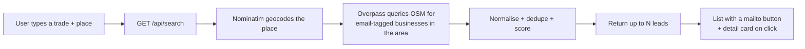

# Aplify

Find businesses you can email — real names, real contact addresses, pulled from
public map data.

Aplify is a single-page web app. You type a trade (**bakeries**, **dentists**)
and a place (**Berlin**, **London**), ask for a number of emails (up to 30), and
get a clean list of businesses with their published email address. Click a name
to open a card with the full record and a confidence rating; click the envelope
to send mail.

There is no sign-up, no API key, and no synthetic data. Every address is read
from a real public record and links back to its source.

---

## Contents

- [How it works](#how-it-works)
- [Where the emails come from](#where-the-emails-come-from) ← the important part
- [Confidence ratings](#confidence-ratings)
- [Coverage and limitations](#coverage-and-limitations)
- [Performance](#performance)
- [Getting started](#getting-started)
- [API reference](#api-reference)
- [Data model](#data-model)
- [Project structure](#project-structure)
- [Attribution and licence](#attribution-and-licence)

---

## How it works



The whole app is one route (`/`). The browser only talks to two server
endpoints:

| Endpoint | Purpose |
| --- | --- |
| `GET /api/search` | Runs a trade + location search and returns leads |
| `GET /api/locations` | Typeahead suggestions for the location field |

Business-type suggestions (the **industry** dropdown) are matched locally in the
browser, so they appear instantly.

---

## Where the emails come from

All contact emails come from **OpenStreetMap (OSM)** — a free, openly licensed,
globally maintained map of the world. Contributors tag businesses with contact
details, and some of those tags are email addresses.

We read exactly two tags:

| OSM tag | Meaning |
| --- | --- |
| `email` | The business's email address |
| `contact:email` | The same, in the `contact:*` namespace used by newer edits |

**We never guess, infer, pattern-match, or generate an address.** If a business
has not published an email in OSM, it is not in the results.

### The pipeline, step by step

**1. Geocode the place.** The location string (`"Berlin"`, `"Lagos, Nigeria"`) is
sent to [Nominatim](https://nominatim.org/), OSM's geocoder. It returns a
bounding box and normalised location labels (city, region, country). The box
comes back as `[south, north, west, east]` and is re-ordered to Overpass's
`(south, west, north, east)`.

**2. Translate the trade into OSM tags.** OSM does not have a "bakeries"
category — it has `shop=bakery`. `lib/osm/tags.ts` maps everyday language to
concrete tags:

```
"bakeries"   → shop=bakery
"dentists"   → amenity=dentist
"law firms"  → office=lawyer
"plumbers"   → craft=plumber
```

The matcher is singularised and accent-insensitive, so `bakeries`, `Bakery`,
`cafés`, and `Café` all resolve correctly. If the phrase is unknown, we fall
back to a name search across the common business keys (`shop`, `amenity`,
`craft`, `office`, `healthcare`, `leisure`, `tourism`).

**3. Ask Overpass for businesses with an email.** [Overpass](https://overpass-api.de/)
is the query engine in front of OSM. For `bakeries` in Berlin we send:

```overpassql
[out:json][timeout:40];
(
  nwr["shop"="bakery"]["email"](52.338,13.088,52.676,13.761);
  nwr["shop"="bakery"]["contact:email"](52.338,13.088,52.676,13.761);
);
out center tags 500;
```

`nwr` means **node, way or relation** — an OSM business can be any of these. The
`email` / `contact:email` filters are what guarantee a real address exists. When
the trade is unmapped, the filter becomes a name match instead:

```overpassql
nwr[~"^(shop|amenity|craft|office|healthcare|leisure|tourism)$"~"."]
   [name~"bike",i]["email"](...);
```

**4. Normalise every record.** Raw OSM tags are messy. For each element we:

- read the name (`name`, `name:en`, or `brand`);
- take the first address from multi-value fields (`a@x.com; b@y.com`);
- validate the address shape and drop anything malformed;
- dedupe by lower-cased email so the same inbox never appears twice;
- assemble city / region / country, falling back to the geocoded place;
- collect phone, website and a formatted street address when present.

**5. Score and sort.** Each lead gets a confidence rating (below). Results are
ordered so that businesses **without** a website come first (they are the ones
most likely to need help), then by confidence, then alphabetically.

**6. Return up to the requested count.** The UI lets the user ask for 1–30
emails; the server clamps to that range and slices — if fewer exist, it returns
what it found.

### Politeness and reliability

The public OSM services are shared infrastructure, so Aplify:

- sends a descriptive `User-Agent` on every request;
- caches geocoding, suggestions and search results in memory for 5 minutes;
- never caches an empty result (so a transient outage is not "sticky");
- retries across **six** Overpass mirrors before giving up, with backoff.

---

## Confidence ratings

We can only assert what we can actually observe: the address is well-formed, and
whether it looks like a shared inbox. We do **not** claim the mailbox exists —
that would require sending mail, which we never do.

| Rating | When | Example |
| --- | --- | --- |
| **High** | A person-shaped address published on a public record | `maria.lopez@panaderia.es` |
| **Medium** | A shared role inbox, with a phone or address to cross-check | `info@backbord.de` + phone |
| **Low** | A shared role inbox with no other contact details | `contact@shop.example` |

Role inboxes (`info@`, `sales@`, `bookings@`, `reception@`, …) are detected from
a curated list plus a prefix rule. The exact reasoning is shown in each lead's
detail card, so nothing is a black box.

---

## Coverage and limitations

Email tags in OSM are **sparse and uneven**. Some markets are rich (German
bakeries, UK dental practices); others have almost no public emails. A search
that legitimately finds nothing is not a bug — it reflects the data.

Other honest caveats:

- **No website filter is absolute.** The app prefers businesses with no website
  and sorts them first, but still lists ones that have one (the website is shown
  in the detail card) rather than hiding valid, real emails.
- **Addresses are only as fresh as OSM.** A record may be years old.
- **No mailbox verification.** Nothing is sent or SMTP-probed.

---

## Performance

The public Overpass API is **slow and bursty** — a single city-wide trade query
routinely takes 30–50 seconds, and the service returns `500`/`502` under load.
For a snappy product, live querying on every search is not good enough.

The target design is a **precomputed local snapshot**:

1. a build script pulls email-tagged businesses for a curated set of major
   markets from Overpass, once;
2. the result is stored locally as a compact dataset;
3. `/api/search` answers from the local dataset in well under a second;
4. the live Overpass path stays as an optional fallback for places outside the
   snapshot.

Until the snapshot ships, the app queries Overpass live with the caching and
mirror-fallback described above, so repeated searches for the same trade and
place are instant.

---

## Getting started

Requires Node.js 20+.

```bash
npm install
npm run dev        # http://localhost:3000
```

Production:

```bash
npm run build
npm run start
```

Lint and type-check:

```bash
npm run lint
npx tsc --noEmit
```

### No configuration needed

Aplify uses only open, keyless services (Nominatim + Overpass). There are **no
environment variables and no API keys** to set.

---

## API reference

### `GET /api/search`

| Query param | Required | Description |
| --- | --- | --- |
| `audience` | yes | Trade, e.g. `bakeries` (min 2 chars) |
| `location` | yes | Place, e.g. `Berlin` (min 2 chars) |
| `limit` | no | 1–30, default 10 |

```jsonc
{
  "query": { "audience": "bakeries", "location": "Berlin", "limit": 10 },
  "leads": [
    {
      "id": "node/123456",
      "businessName": "Bäckerei Neumanns",
      "category": "Bakery",
      "location": { "city": "Berlin", "country": "Germany", "display": "Berlin, Germany" },
      "email": "hallo@neumanns-berlin.de",
      "confidence": "high",
      "confidenceReason": "A named address published on a public map record.",
      "website": null,
      "source": { "name": "OpenStreetMap", "url": "https://www.openstreetmap.org/node/123456" }
    }
  ],
  "count": 1,
  "generatedAt": "2026-01-01T00:00:00.000Z"
}
```

Errors return `{ "error": { "message": "…" } }` with `400` (bad input) or `502`
(map service unavailable).

### `GET /api/locations?q=Berl`

Returns up to five place suggestions for the typeahead:

```jsonc
{
  "suggestions": [
    { "value": "Berlin, Germany", "label": "Berlin", "hint": "Germany" }
  ]
}
```

---

## Data model

The canonical shape is `Lead` in `lib/types.ts`:

| Field | Notes |
| --- | --- |
| `id` | OSM identifier, e.g. `node/123456` |
| `businessName` | From `name` / `name:en` / `brand` |
| `category` | Humanised primary OSM tag |
| `location` | city, region, country, display string, lat/lon |
| `email` | The real published address |
| `emailIsRole` | Shared inbox (`info@`) vs person-shaped |
| `confidence` / `confidenceReason` | See [Confidence ratings](#confidence-ratings) |
| `phone`, `address`, `website` | Extra detail when OSM has it |
| `source` | Name, record URL, licence, retrieval time |

---

## Project structure

```
app/
  page.tsx                 one-page UI: search + list + modal
  layout.tsx               fonts, header, metadata
  api/search/route.ts      trade + location search
  api/locations/route.ts   location typeahead
components/
  search/combobox.tsx      accessible typeahead input
  leads/business-modal.tsx detail card with confidence
  leads/confidence-badge.tsx
  ui/                       button, card primitives
lib/
  osm/overpass.ts          geocoding, Overpass query builder, normalisation
  osm/tags.ts              trade → OSM tag mapping
  osm/email.ts             syntax check, role detection, confidence scoring
  osm/suggestions.ts       local business-type suggestions
  store/discovery.tsx      client search state
  types.ts                 domain types
```

---

## Attribution and licence

Business data is © [OpenStreetMap](https://www.openstreetmap.org/copyright)
contributors, available under the
[Open Database Licence (ODbL) 1.0](https://opendatacommons.org/licenses/odbl/).
Aplify surfaces an attribution line in the app and links every lead back to its
source record, as the licence requires.
# aplify

